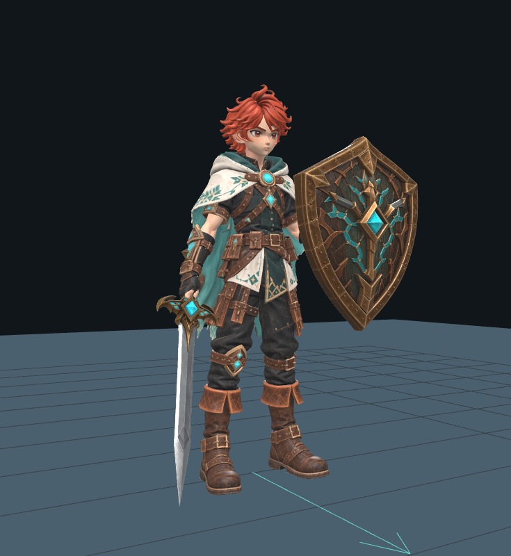

# Ruen: prueba de Idle con espada y escudo

Estado: **montaje revisado visualmente y pruebas locales aprobadas; publicación pendiente**.
Esta variante sirve para revisar la postura de Ruen sosteniendo los modelos
reales entregados. Se muestra sólo en el visor y no modifica el combate.

Captura real del navegador, en tres cuartos. Se revisaron también las vistas
frontal, lateral y trasera, con el modelo, rig y equipo originales.

## Abrir la prueba local

Con `npm run dev`, abre `/?inspect=ruen&motion=idle-v1&equipment=azure`.
El modelo de Ruen, Azure Oathblade y Aegis of the Azure se cargan automáticamente.
El visor selecciona **Idle con espada y escudo** en pausa. Pulsa **Reproducir**,
usa las vistas frontal, lateral y trasera, o arrastra para revisar el agarre.

Desmarca **Espada y escudo (Idle)** para comparar con el Idle neutro. La
comparación conserva el momento del ciclo, velocidad y reproducción. Elegir
Walking, Running u otro clip original oculta el equipo y restaura los canales
de la postura equipada. Si falla la carga de una pieza, queda disponible el
Idle sin equipo y el botón **Reintentar carga del equipo**.

La ruta `?inspect=ruen&motion=idle-v1` conserva la prueba neutra anterior y no
descarga espada ni escudo. El juego mantiene su comportamiento actual.

## Archivos originales

Los dos adjuntos se conservan en `public/assets/models/ruen/equipment/`:

| Modelo | Archivo | Bytes | Vértices | Triángulos |
| --- | --- | ---: | ---: | ---: |
| Espada | `Meshy_AI_Azure_Oathblade_1022220336_texture.glb` | 14,817,508 | 118,713 | 218,230 |
| Escudo | `Meshy_AI_Aegis_of_the_Azure_St_1022222231_texture.glb` | 29,661,132 | 365,780 | 688,602 |

SHA-256 de la espada:
`111ea36ba748b0ff3d49651411cbb94bdd4bf4ca3f1728337be5d6b271e1e04d`.

SHA-256 del escudo:
`b639b29cd66260064cac6ea13f26764dd8c23e561b92da4440ce4e8b77ac7e23`.

Cada archivo tiene una malla rígida, un material PBR opaco de doble cara y
tres texturas JPEG 2048²: color, metal/rugosidad y normal. No trae esqueleto,
animaciones ni sockets. Se conservan los bytes originales, materiales y
texturas; no se redujo geometría. El master de Ruen también permanece intacto.

## Montaje y animación

La espada usa `mixamorig:RightHand`; el escudo, `mixamorig:LeftHand`. Los nodos
de montaje siguen esos joints reales y mantienen la conversión glTF debajo.
Escala, orientación y posición se aplican fuera de los archivos importados.
El mango y el asa posterior existen en las mallas originales: no se crean
piezas sustitutas.

`Ruen_Idle_Armed_v1` dura cuatro segundos a 30 FPS. Reutiliza las dos curvas
de respiración del Idle neutro y añade claves constantes para brazos, manos
y dedos. El inventario conserva los 20 clips originales del master; los dos
Idle propios quedan identificados por separado. El equipo tiene su propio
inventario en el informe JSON del visor.

Los dos objetos suman 906,832 triángulos y añaden 44.48 MB a la carga inicial
de esta ruta. Es una prueba con los originales completos; todavía no hay una
medición de rendimiento en el equipo del usuario. Una futura optimización
debe generar copias independientes y conservar estos masters.

La calibración en navegador terminó sin errores de aplicación. Se comprobó
la orientación de ambos objetos usando los agarres medidos en las mallas;
la aprobación artística del usuario sigue pendiente. Tras el ajuste final
aprobaron typecheck, build, **142 pruebas unitarias en 15 archivos y 10 casos
únicos de navegador**. Los casos pasaron en dos ejecuciones sin reintentos:
nueve en 6.1 minutos y uno en 28.5 segundos. Se usaron servidores locales de
desarrollo y producción; no es una medición de FPS ni una comprobación del sitio remoto.
[Capturas de las tres vistas e inventario](evidence/ruen-equipment/README.md).

Queda aprobar el encaje visual, comprobar las transiciones jugables e integrar el
equipo en locomoción, guardia y golpes antes de activarlo dentro del juego.
La pose del visor no define eventos de daño ni sustituye animaciones de combate.
