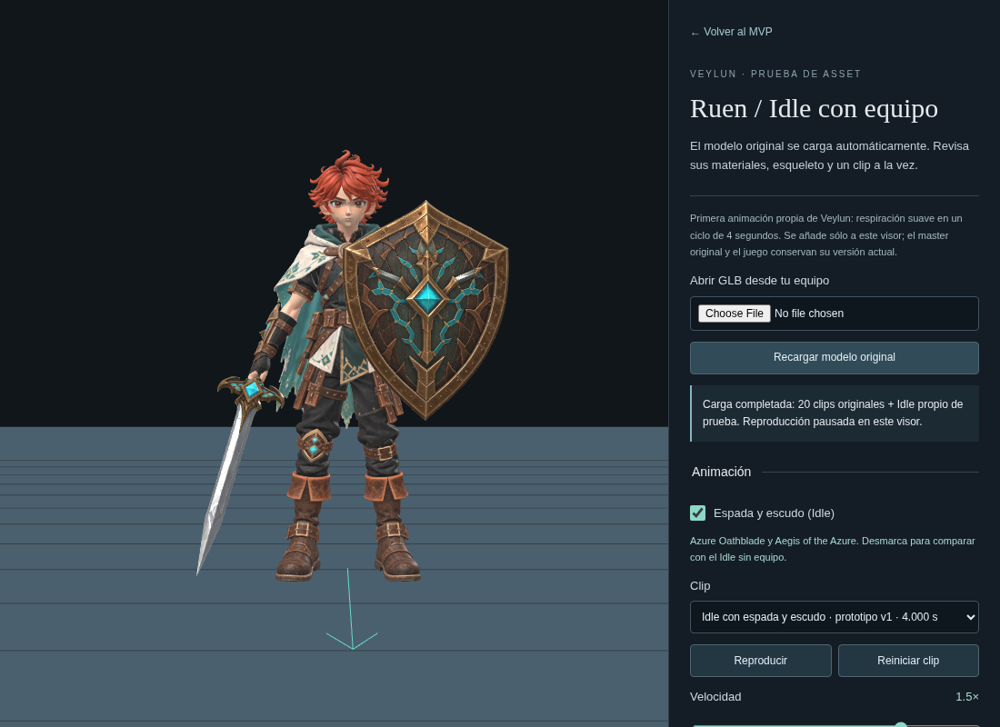
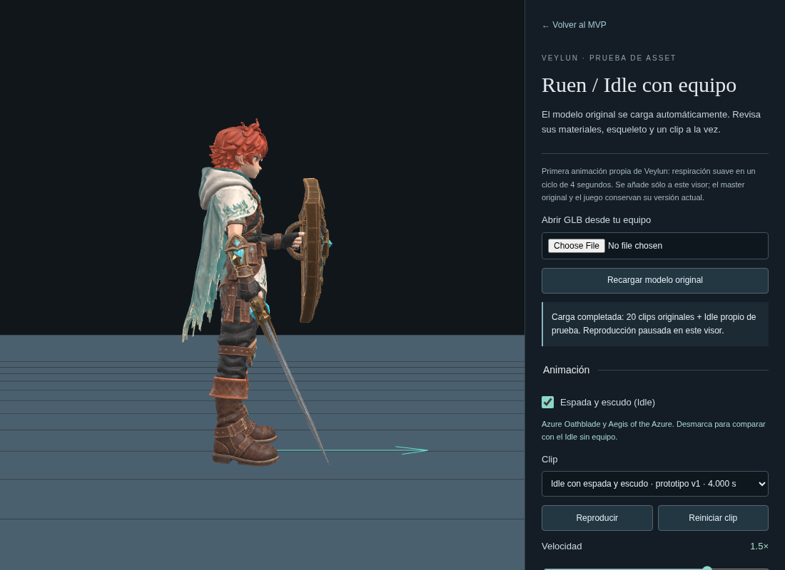
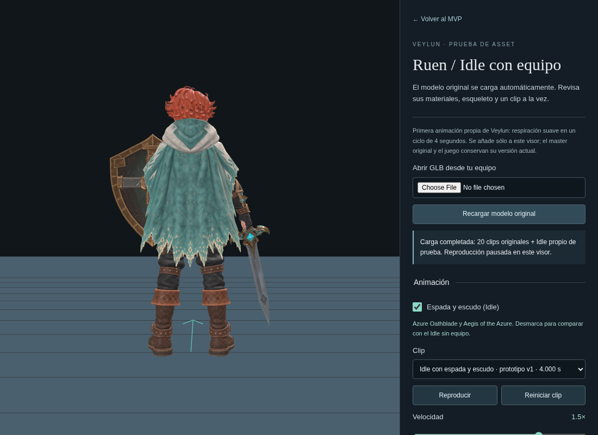

# Idle con equipo: evidencia del prototipo

22 de octubre de 2026. Capturas reales de Chromium del Idle equipado sobre
el master intacto de Ruen y los dos GLB entregados. Muestran la revisión final
del montaje, con espada en la mano derecha y escudo en la izquierda.

| Frontal | Lateral | Trasera |
| --- | --- | --- |
|  |  |  |

[Vista en tres cuartos](../../images/ruen-equipped-idle.png) ·
[Inventario de los originales](source-inventory.json) ·
[Uso y alcance](../../RUEN_EQUIPMENT_PREVIEW.md).

Typecheck, build, **142 pruebas unitarias en 15 archivos y 10 casos únicos de
navegador** aprobaron tras el ajuste final. Las dos ejecuciones de navegador
terminaron sin reintentos ni cambios de aplicación: nueve casos en 6.1 minutos
y uno en 28.5 segundos. [Registro de ejecución](browser.log).

- Tres casos del equipo real: carga automática, seguimiento de manos, loop,
  comparación con el Idle neutro, restauración de poses, liberación de recursos,
  fallo/reintento y controles en producción sin hooks de desarrollo.
- Tres regresiones del Idle neutro y tres del visor con fixture sintético.
- Un caso adicional del master real en el visor original, con Walking/Running.

Las pruebas usaron Chromium con renderizado de software y servidores locales
de desarrollo y producción. No se presenta esta ejecución como comprobación
del sitio remoto.

El montaje y los materiales se revisaron de frente, lado y espalda. La
calibración terminó sin errores de aplicación. El script de capturas agotó
el tiempo en un primer intento; terminó al capturar con render pausado.
Ese incidente de captura no se interpreta como una validación de rendimiento.

Los originales conservan geometría, materiales, texturas y hashes. Los
906,832 triángulos del equipo corresponden a esta prueba sin optimización.
El prototipo permanece fuera del gameplay; la aprobación artística, las
transiciones jugables y el rendimiento en el equipo del usuario siguen pendientes.

El prototipo está [publicado](https://dabot11.github.io/Veylun/?inspect=ruen&motion=idle-v1&equipment=azure).
Fuente `15a6a6c52d224303e79a01e24255ee74b31cc2e4`, con el mismo árbol que la
revisión probada `bba241905e99869e2234a718f9c6c10096cb332c`; build
`844381b13cde0f13289091479ccb6bac913a4249`.
[Actions 39868086193](https://github.com/Dabot11/Veylun/actions/runs/39868086193)
confirmó **Success**. La fuente también se comprobó en `deployment.json` de
`gh-pages`. La red del entorno impide comprobar directamente el dominio público.
