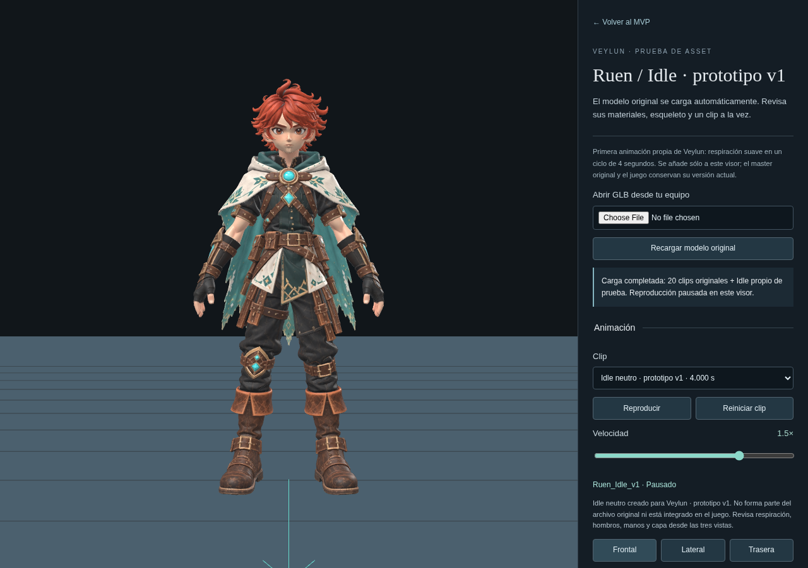
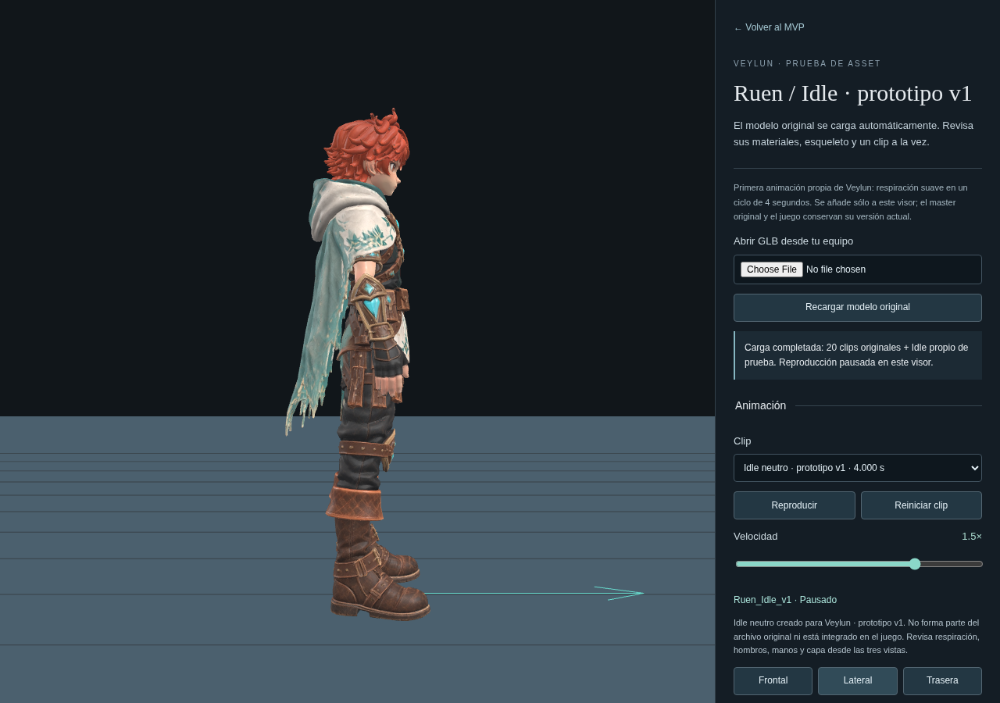
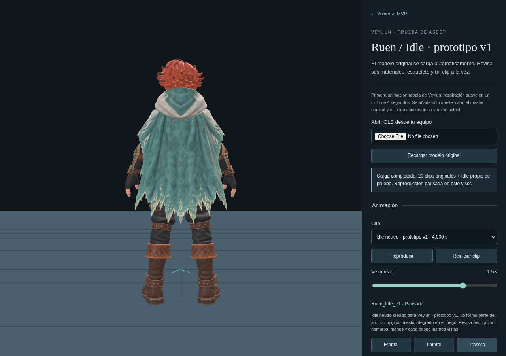

# Idle propio v1: evidencia del prototipo

22 de octubre de 2026. Capturas reales de Chromium sobre el master intacto.
Muestran la inhalación máxima (frame 60 a 30 fps) de `Ruen_Idle_v1`; no son
renders generados ni el fixture sintético. La amplitud conjunta del torso es
1.3 grados; no hay animación independiente de capa o manos.

| Frontal | Lateral | Trasera |
| --- | --- | --- |
|  |  |  |

Typecheck y build correctos; **130 pruebas unitarias en 13 archivos** y
**7 casos únicos de navegador aprobados**. La primera ejecución aprobó cuatro
casos y perdió tres al cerrarse el servidor de desarrollo (carga interrumpida
y `ERR_CONNECTION_REFUSED`). Después de reiniciarlo, esos tres casos pasaron
en 1.3 minutos, sin cambios de código ni relajación de comprobaciones.

- [Primera ejecución: cuatro aprobados y tres interrumpidos](browser-initial.log).
- [Repetición de los tres interrumpidos: aprobados](browser-recheck.log).
- Casos: tres regresiones del visor sintético, dos del Idle con master real
  (desarrollo/producción), uno de rig incompatible y uno del visor original
  con master real.
- Se comparan root, pelvis y cadenas de piernas/pies en cinco frames; no
  cambian. El torso cambia, y el inicio/final coinciden exactamente.
- Se comprueban pausa, velocidad, exclusividad, regreso desde Walking/Running,
  guardado intacto y ausencia de hooks de desarrollo en producción.
- Las pruebas del módulo también comprueban cierre suave, bind matrices
  intactas, ownership y rechazo de rigs/nombres incompatibles.

La revisión visual cubre las tres vistas en la pose máxima; no equivale a
aprobación artística final. El prototipo sigue fuera del gameplay. Xbox físico,
rendimiento en Mac y transiciones del Idle dentro del juego no se probaron.
La suite completa del juego anterior conserva su registro propio; no se
repite para este cambio aislado del visor. El aviso de chunk glTF >500 kB
permanece. La publicación del prototipo está pendiente.
