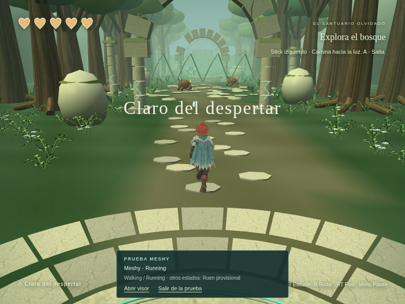
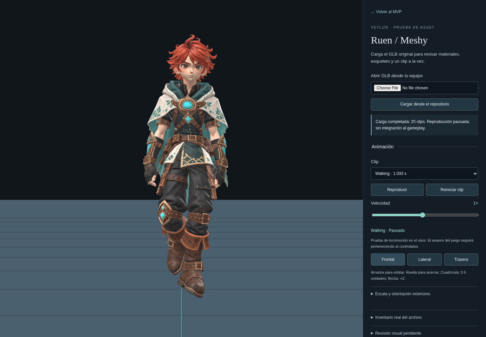
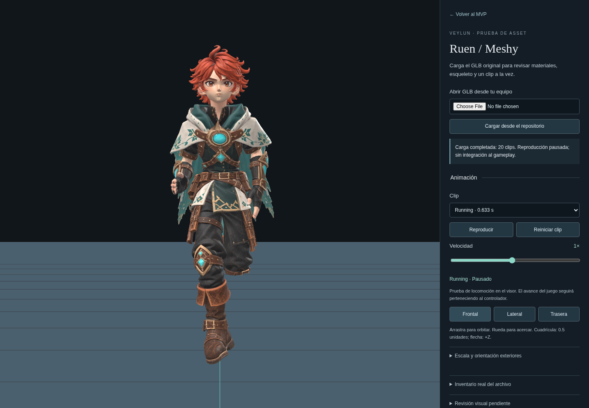
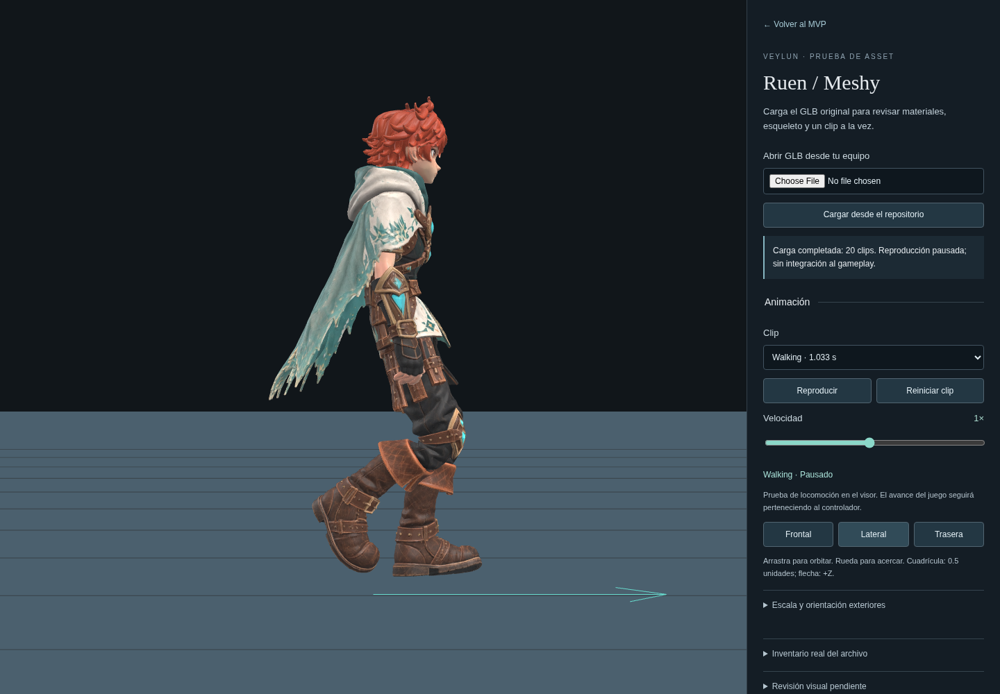
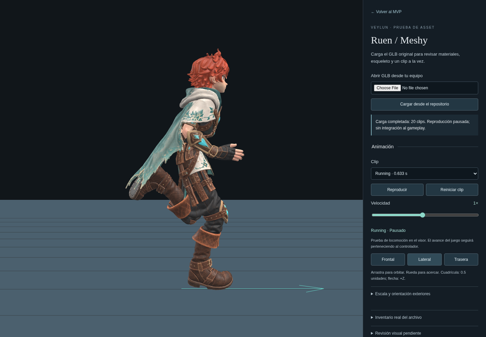
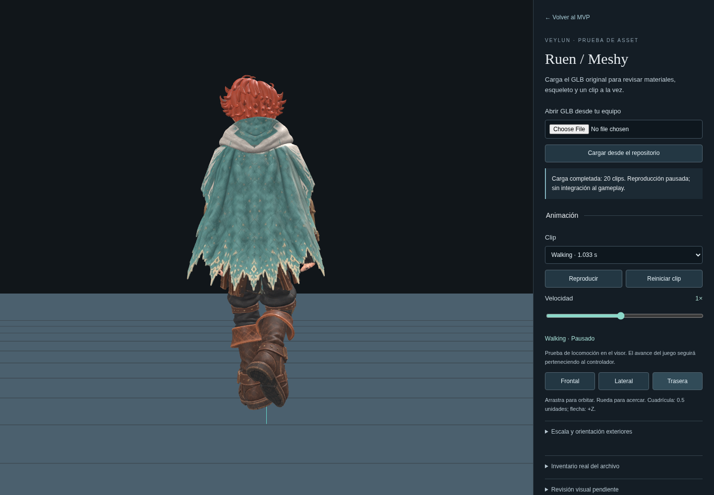
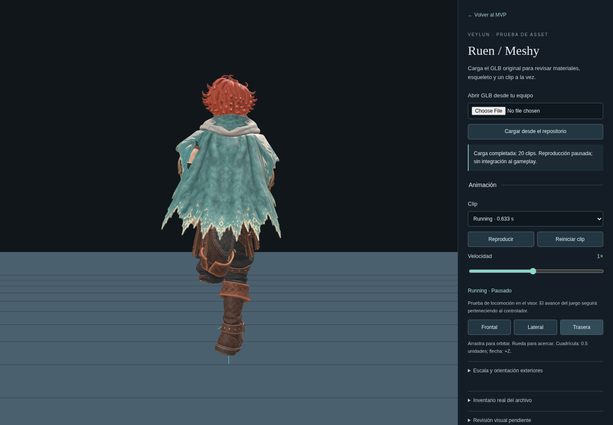

# Evidencia real de Ruen / Meshy

Capturas de Chromium sobre el master intacto del release `ruen-modelo-prueba`,
22 de octubre de 2026. No son renders generados ni el fixture sintético.

## Prueba jugable

Walking y Running están conectados en el modo `?ruen=meshy`. Reposo, salto,
esquiva, ataque y defensa siguen usando explícitamente el rig provisional.
Esta captura muestra Running con el modelo real; no valida todos sus clips.

## Visor aislado

Se revisaron muestras de manos, hombros, rodillas y capa desde estas tres
vistas. Son comprobaciones iniciales, no aprobación final del arte.

| Vista | Walking | Running |
| --- | --- | --- |
| Frontal |  |  |
| Lateral |  |  |
| Trasera |  |  |

## Registros

- [Auditoría binaria del master](master-audit.json): hash, malla, skin, materiales y 20 clips.
- [Inventario de Babylon en navegador](browser-inventory.json).
- [Consola de la inspección](inspector-console.json): sin errores.
- [Muestras matemáticas de piel y pies](locomotion-skin-samples.json).
- [Suite completa de navegador](full-browser.log): 24/24 aprobadas, sin reintentos.

También pasaron typecheck, build y 119 pruebas unitarias en 12 archivos.
El build informa un chunk glTF mayor de 500 kB; no impide la compilación.
El caso de descarga abortada genera avisos esperados y comprueba el fallback.
El mando usado es simulado; Xbox físico y rendimiento en el Mac de David no
se han probado. Ver [alcance, faltantes y reversión](../../RUEN_MESHY_INSPECTION.md).
