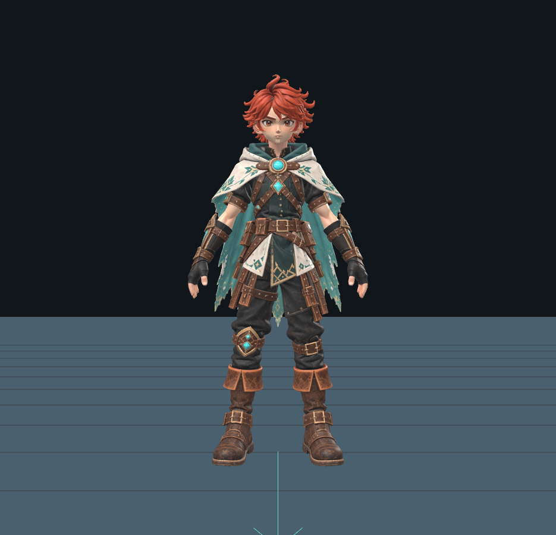
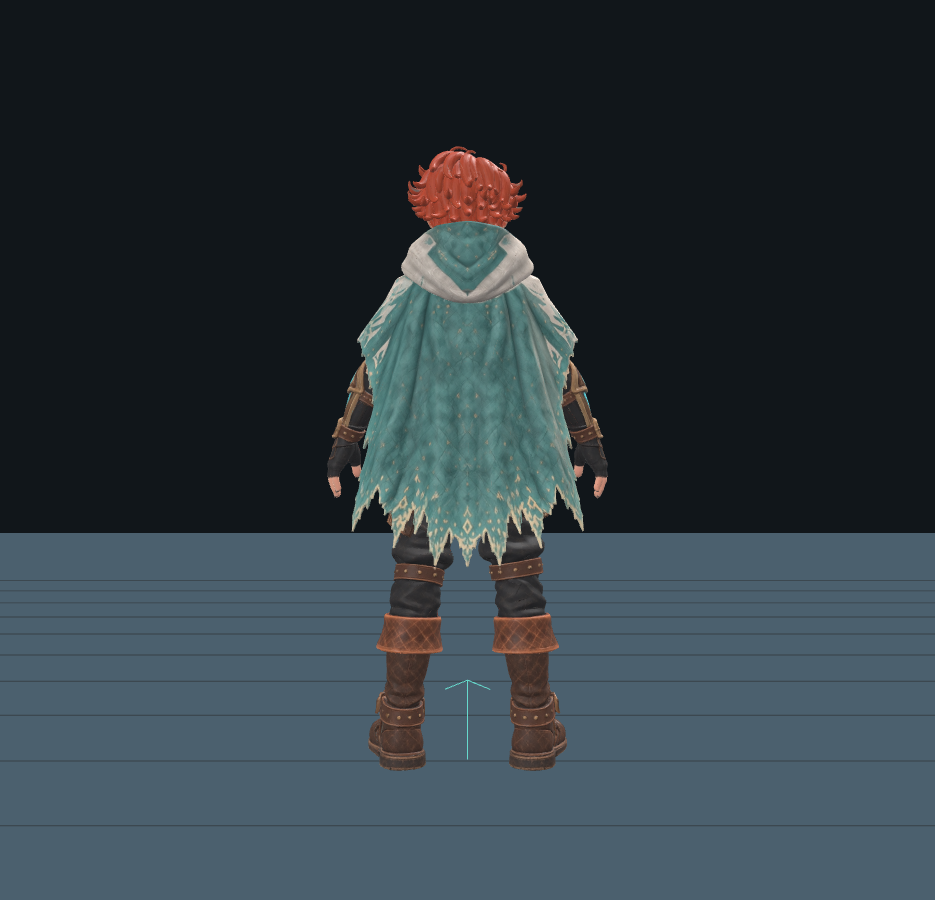
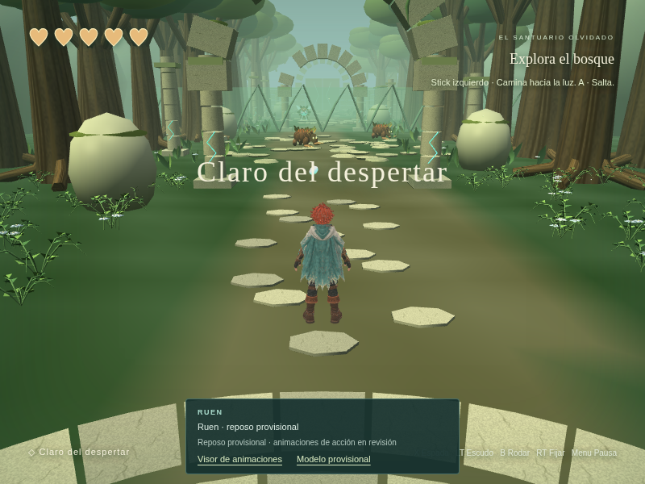
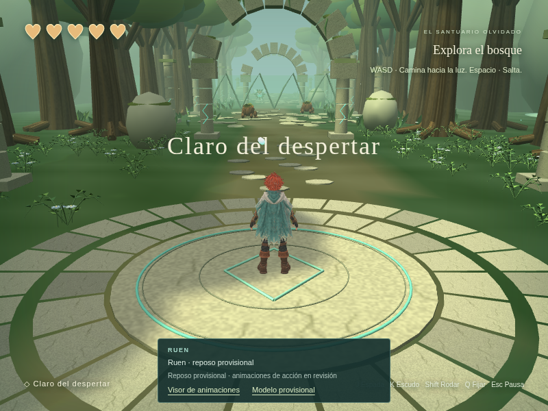

# Evidencia real de Ruen / Meshy

Capturas de Chromium sobre el master intacto del release `ruen-modelo-prueba`,
22 de octubre de 2026. No son renders generados ni el fixture sintético.

## Reposo estático de la nueva integración

Pose base exacta del master, revisada desde el visor. Los pies quedan apoyados
y la capa estable; no es una animación Idle ni incluye respiración. La nueva
integración la utiliza al detenerse y carga el modelo automáticamente.

| Frontal | Trasera |
| --- | --- |
|  |  |

La ruta normal del juego carga Ruen automáticamente. Estas capturas muestran
el reposo después de correr y el inicio desde el build de producción:

**Validación actual:** typecheck y build correctos; 123 pruebas unitarias en
12 archivos y 26 de navegador aprobadas en una ejecución de 18.6 minutos sin
reintentos. [Log completo](default-idle-browser.log). La pose se compara con
los valores locales originales después de correr y permanece estable.

Son cuatro casos con carga del master real, dos de fallo/opt-out, tres del
visor con fixture sintético y 17 regresiones del MVP. La prueba de producción
usa el servidor local; no se midieron FPS ni se probó Xbox físico. La
validación se detalla en el [informe principal](../../VALIDATION.md).

La fuente `2045061` está publicada en [Veylun](https://dabot11.github.io/Veylun/).
[Actions 39839671135](https://github.com/Dabot11/Veylun/actions/runs/39839671135)
confirmó el despliegue con **Success**. Las capturas anteriores proceden de
servidores locales; el dominio público está restringido desde este entorno.

## Prueba jugable anterior: 6a80022

Walking y Running están conectados en el modo `?ruen=meshy`. Reposo, salto,
esquiva, ataque y defensa siguen usando explícitamente el rig provisional.
Esta captura muestra Running con el modelo real; no valida todos sus clips.

## Visor aislado

Se revisaron muestras de manos, hombros, rodillas y capa desde estas tres
vistas. Son comprobaciones iniciales, no aprobación final del arte.

| Vista | Walking | Running |
| --- | --- | --- |
| Frontal |  |  |
| Lateral |  |  |
| Trasera |  |  |

## Registros de la revisión anterior

- [Auditoría binaria del master](master-audit.json): hash, malla, skin, materiales y 20 clips.
- [Inventario de Babylon en navegador](browser-inventory.json).
- [Consola de la inspección](inspector-console.json): sin errores.
- [Muestras matemáticas de piel y pies](locomotion-skin-samples.json).
- [Suite completa de navegador](full-browser.log): 24/24 aprobadas, sin reintentos.

También pasaron typecheck, build y 119 pruebas unitarias en 12 archivos.
El build informa un chunk glTF mayor de 500 kB; no impide la compilación.
El caso de descarga abortada genera avisos esperados y comprueba el fallback.
El mando usado es simulado; Xbox físico y rendimiento en el Mac de David no
se han probado. Ver [alcance, faltantes y reversión](../../RUEN_MESHY_INSPECTION.md).
